 

  
  
  
  

  
  
  
  
  
  
  
  

 

**[Install](#installation)** &nbsp;|&nbsp; **[How to use](#how-to-use)** &nbsp;|&nbsp; **[Settings](#settings)** &nbsp;|&nbsp; **[Alerts](#alerts)** &nbsp;|&nbsp; **[Terminology](#basic-terminology)** &nbsp;|&nbsp; **[License](#license)**

 

> A Pine Script&trade; v6 indicator that automatically marks **market structure**, **BMS / BOS**, **CHoCH**, the **trading range** with **Premium / Discount / Equilibrium**, **Order Blocks**, **Fair Value Gaps**, **EQH / EQL liquidity**, **session levels**, **fractals**, and **alerts**.

---

## Watch it in action

> **Animation only, not financial advice.** This is a visual illustration, not a lesson or a recommendation.

An illustrated walkthrough of how a trade could play out with SMC Marks on a TradingView-style chart. In the example, the trader waits for a **CHoCH**, marks **Discount**, places a **Buy** with SL and TP and watches it hit target. Then price flips bearish and the trader places a **Sell** from **Premium** the same way.

| Step | What the animation shows |
|---|---|
| 1 | Structure is bearish (LH, LL). Wait for a **CHoCH**. |
| 2 | CHoCH breaks the last LH. Bias flips bullish and the **Discount** zone is marked. |
| 3 | **Buy**: entry in Discount, **SL** below the HL, **TP** at 3R. |
| 4 | Let the trade play out. TP is hit for **+3R**. |
| 5 | New HH and a **BMS**, then a bearish CHoCH flips bias again. |
| 6 | **Sell**: entry in Premium, **SL** above the LH, **TP** at 2.5R. TP is hit for **+2.5R**. |

> **Animation only.** The price action in this demo is made up to illustrate how a trade *could* play out. It is **not a real trade, not financial advice, and not a trading lesson**, and it is not a promise of results.

---

## Overview

This Smart Money Concept (SMC) indicator combines the core features needed to trade SMC techniques in a single tool. It is built on Smart Money Concepts inspired by Inner Circle Trader (ICT) teachings.

"Smart Money" refers to the capital allocated by institutional investors, funds, and other large financial market participants. This indicator takes that institutional trading behaviour and makes it accessible to retail traders, giving you machine-drawn insight into the market.

It provides the most important SMC principles in one indicator. Break of Market Structure, Change of Character, Current Trading Range, Premium & Discount, Fractals, and Swing Structure are all fully automated and update in real time. On top of these, it includes an SMC market structure trend built on the market structure principle, and an optional confirmed swing-trend background that makes the trend easier to read at a glance.

### Key features

- **Swing Structure**: identifies major market structure and labels every confirmed swing as **HH**, **HL**, **LH**, or **LL**.
- **Current Trading Range**: always shows where the current range is and where Premium and Discount sit inside it. The range updates in real time with no delay.
- **Premium & Discount Zones**: Premium, Discount, and Equilibrium zones are drawn automatically.
- **Structure Breaks**: Break of Market Structure (**BMS/BOS**) and Change of Character (**CHoCH**) are identified and plotted in real time. Minor (internal) breaks, **MBOS** and **iCHoCH**, are optional.
- **Supply and Demand**: Order Blocks mark high-probability supply and demand zones and are removed once they are mitigated.
- **Imbalances (FVG)**: three-candle Fair Value Gaps shrink as they are partially filled and are removed when fully filled (Gap Fill).
- **Liquidity**: Equal Highs (**EQH** = Buy Side Liquidity) and Equal Lows (**EQL** = Sell Side Liquidity).
- **Session Levels**: High / Low of the Day (**HOD / LOD**) and High / Low of the Week (**HOW / LOW**).
- **Fractals**: classic 5-bar fractal highs and lows.
- **Dashboard**: shows the current trend (Positive / Negative / Neutral) and the Upper, Lower, and Mid levels of the range.
- **On-chart SMC Glossary**: a toggleable table of every abbreviation.
- **Hover tooltips**: every label on the chart explains what it means when you hover over it.
- **Alerts** for CHoCH, BMS, internal breaks, new HH/LL, EQH/EQL, and price entering Premium or Discount.

---

## Installation

1. Open [TradingView](https://www.tradingview.com/) and load any chart.
2. Open the **Pine Editor** tab at the bottom of the screen.
3. Delete the template code, then copy and paste the full contents of [`SMC_Terminology_marks.pine`](SMC_Terminology_marks.pine).
4. Click **Save**, then **Add to chart**.
5. Click the ⚙️ gear icon next to the indicator name on the chart to open **Settings**.

---

## How to use

1. **Read the trend first.** The dashboard (top right by default) shows the current swing trend. **Positive** (green) is bullish structure and **Negative** (red) is bearish. You can turn on *Confirmed Swing Trend Background* to shade the chart as well.
2. **Follow structure.** In an uptrend, look for **HH → HL** sequences with bullish **BMS/BOS** confirming continuation. In a downtrend, look for **LH → LL** with bearish BMS/BOS.
3. **Watch for a CHoCH.** A **CHoCH** is the first break *against* the current trend. It is often the earliest sign of a possible reversal.
4. **Use Premium & Discount.** In a bullish trend, look for buys from the **Discount** zone (the lower part of the range). In a bearish trend, look for sells from the **Premium** zone (the upper part). **Equilibrium** is the 50% level of the range.
5. **Refine entries with POIs.** Turn on **Order Blocks** and **Fair Value Gaps** to find precise Points of Interest inside Premium or Discount.
6. **Mind the liquidity.** **EQH** / **EQL** show where resting liquidity (BSL / SSL) sits. Price is often drawn to these levels before a move. HOD/LOD and HOW/LOW act as liquidity targets too.
7. **Use multiple timeframes.** Set your bias on the HTF, then drop to the LTF and wait for a CHoCH or MBOS in the direction of that bias before you enter.
8. **Set alerts.** Right-click the chart, choose **Add alert**, pick **SMC Marks** as the condition, then choose the event (e.g. *Bullish CHoCH*).

> Most extra features (Order Blocks, FVGs, EQH/EQL, session levels, fractals, internal structure) are **off by default** to keep the chart clean. Turn on only what you need.

---

## Settings

### Market Structure (Swing)

| Setting | Default | Description |
|---|---|---|
| Market Structure Period | `10` | Bars required on each side to confirm a swing high/low. Scalping: 3–5, Day Trading: 5–10, Swing Trading: 10–20, Trend Trading: 20–50. |
| Break Confirmation | `Close` | **Close**: a candle must close beyond the swing level. **Wick**: any wick beyond the level counts as a break. |
| Continuation Label | `BMS` | Text used for a break in the direction of the trend: `BMS` or `BOS`. |
| Show HH / HL / LH / LL | On | Labels each confirmed swing point. |
| Show BMS / CHoCH | On | Draws structure-break lines and labels. |
| Label Size | `Small` | Tiny / Small / Normal. |
| Colours | — | Bullish/Bearish trend, BMS/BOS, CHoCH, HH, HL, LH, LL. |
| Confirmed Swing Trend Background | Off | Shades the chart background green or red according to the swing trend. |

### Internal Structure (Minor)

| Setting | Default | Description |
|---|---|---|
| Show MBOS / iCHoCH | Off | Minor (internal) structure breaks, drawn with dashed lines. |
| Internal Structure Period | `5` | Pivot length used for internal structure. |
| Colours | — | MBOS, iCHoCH. |

### Current Trading Range

| Setting | Default | Description |
|---|---|---|
| Show Trading Range | On | Shades the current dealing range and marks the Upper / Lower Range. |
| Show Premium / Discount / Equilibrium | On | Draws the Premium, Discount, and Equilibrium zones. |
| Zone Depth % | `20` | Height of the Premium and Discount zones as a % of the range. |
| Zone Offset From Range Edge % | `5` | Gap between the range edge and the Premium/Discount zone. |
| Equilibrium Band Width % | `5` | Thickness of the Equilibrium band around the 50% level. |
| Extend Right (bars) | `20` | How far the zones and levels extend past the current bar. |
| Colours | — | Range, Premium, Equilibrium, Discount. |

### Order Blocks (Supply & Demand)

| Setting | Default | Description |
|---|---|---|
| Show Order Blocks | Off | **Demand OB**: the lowest candle before a bullish break. **Supply OB**: the highest candle before a bearish break. |
| Max Blocks Per Side | `3` | Number of active blocks kept per side. |
| Mitigation | `Close` | Whether a close or a wick through the block removes it. |
| Colours | — | Demand, Supply. |

### Imbalance (FVG / IMB)

| Setting | Default | Description |
|---|---|---|
| Show Fair Value Gaps | Off | Three-candle imbalances. Partially filled gaps shrink and fully filled gaps are removed. |
| Min Gap Size (x ATR) | `0.0` | Filters out small gaps (multiple of ATR 200). |
| Max Gaps Per Side | `5` | Number of active gaps kept per side. |
| Colours | — | Bullish, Bearish. |

### Liquidity (EQH / EQL)

| Setting | Default | Description |
|---|---|---|
| Show Equal Highs / Lows | Off | EQH marks Buy Side Liquidity above, EQL marks Sell Side Liquidity below. |
| Confirmation Bars | `3` | Pivot length used to detect equal highs and lows. |
| Threshold (x ATR) | `0.1` | How close two pivots must be (as a multiple of ATR) to count as "equal". |
| Colours | — | EQH, EQL. |

### Session Levels

| Setting | Default | Description |
|---|---|---|
| Show HOD / LOD | Off | Running High / Low of the Day (intraday charts only). |
| Show HOW / LOW | Off | Running High / Low of the Week (charts below the weekly timeframe). |
| Colours | — | HOD/LOD, HOW/LOW. |

### Fractals

| Setting | Default | Description |
|---|---|---|
| Show Fractals | Off | Classic 5-bar fractal highs (▼) and lows (▲). |

### Dashboard

| Setting | Default | Description |
|---|---|---|
| Show Trend / Range Table | On | Trend state plus Upper Range, Lower Range, and Mid values. |
| Position | `Top Right` | Where the dashboard sits on the chart. |
| Show SMC Glossary | Off | On-chart table of SMC abbreviations. |
| Glossary Position | `Bottom Left` | Where the glossary sits on the chart. |

---

## Alerts

| Alert | Triggers when |
|---|---|
| Bullish CHoCH / Bearish CHoCH | Swing structure breaks against the trend |
| Bullish BMS / Bearish BMS | Swing structure breaks in the direction of the trend |
| Bullish / Bearish Internal Break | An internal MBOS or iCHoCH occurs |
| New Higher High / New Lower Low | A new HH or LL is confirmed |
| Equal Highs / Equal Lows | EQH (BSL) or EQL (SSL) is detected |
| Price Entered Premium / Discount | Close crosses into the Premium or Discount zone |

---

## Basic Terminology

| Abbreviation | Meaning |
|---|---|
| SBD | Supply & Demand |
| S2D | Supply to Demand |
| D2S | Demand to Supply |
| OB | Orderblock |
| AOI | Area of Interest |
| POI | Point of Interest |
| LoR | Level of Respect |
| FLOR | First Level of Respect |
| IMB | Imbalance |
| Inefficiency | A price move with one-sided order flow that leaves an unfilled gap (see FVG) |
| IRL | Internal Range Liquidity |
| FML | Fair Value Gap Liquidity |
| FVG | Fair Value Gap |
| HH | Higher High |
| HL | Higher Low |
| LH | Lower High |
| LL | Lower Low |
| BOS | Break of Structure |
| BMS | Break of Market Structure |
| RBOS | Retail Break of Market Structure |
| MBOS | Minor Break of Structure |
| SMC | Smart Money Concepts |
| CHoCH | Change of Character |
| EQH | Equal Highs |
| EQL | Equal Lows |
| BSL | Buy Side Liquidity |
| SSL | Sell Side Liquidity |
| LQ | Liquidity |
| ES | Equilibrium |
| PA | Price Action |
| HTF | Higher Timeframe |
| LTF | Lower Timeframe |
| FT | Fibonacci |
| CF | Confirmed Trend |
| OF | Orderflow |
| EXO | External Orderflow |
| LOD | Low of the Day |
| HOD | High of the Day |
| HOW | Highs of the Week |
| LOW | Lows of the Week |
| RE | Risk Entry |
| RR | Risk Reward |
| GF | Gap Fill |
| HFs | Hedge Funds |

---

## Support the project

If this indicator helps your trading, a free way to say thanks:

 

---

## Disclaimer

This indicator is for educational and informational purposes only and is **not financial advice**. Trading forex, CFDs, and other leveraged products carries a high level of risk and may not be suitable for all investors. Always do your own analysis and manage your risk.

## License

**Free to use. Free to share. Not for sale.**

This project is released under the [SMC Marks Free Use License (Non-Commercial)](LICENSE).

| You can | You cannot |
|---|---|
| Use it for your own trading | Sell it or any modified version of it |
| Copy, modify and share it for free | Put it behind a paywall, subscription, course, or paid group |
| Learn from it and build on it | Remove the author credit or this license |

Want to use it commercially? Ask for written permission first.

&copy; [kxngHADES](https://github.com/kxngHADES)

